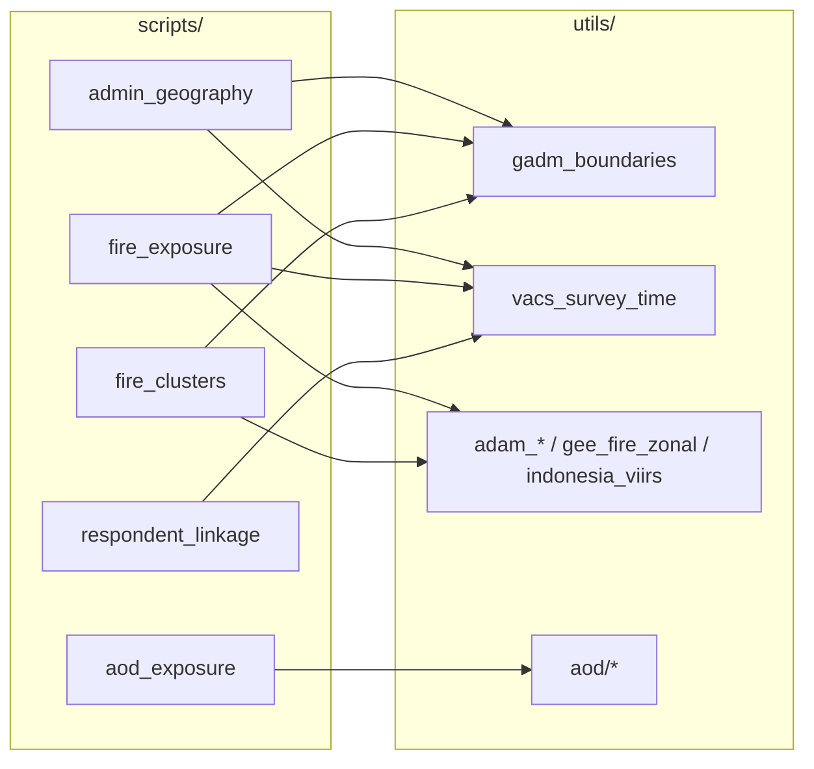
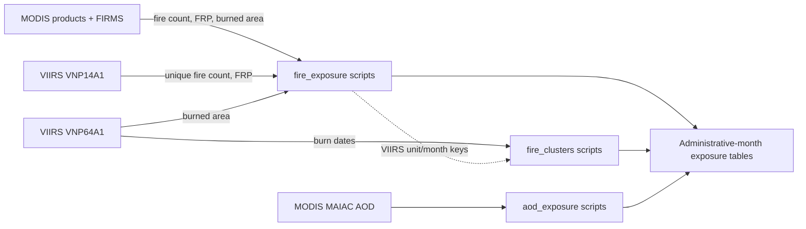
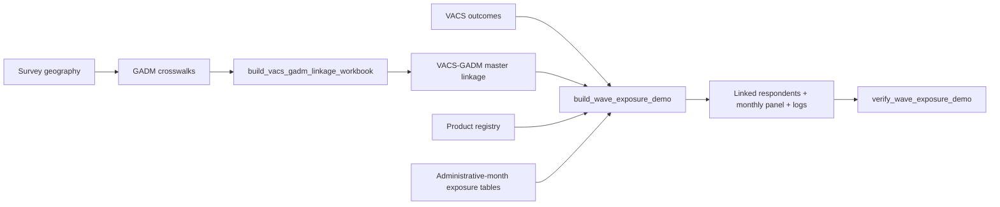

# VACS satellite exposure and linkage

Code to build administrative satellite exposure measures and link them to VACS respondents using approved survey dates and geography.

## How the code fits together

`scripts/` contains entry points, `utils/` contains reusable calculations, and `config/` records run and product choices.

## Exposure measures

FRP means fire radiative power; AOD means aerosol optical depth. The fire-cluster branch counts connected VNP64A1 burn patches, not verified ignitions.

## Respondent linkage

A wave's exposure products are selected by `config/wave_exposure_products.csv`; the linked file keeps the source respondents and records join status.

## Review guides

| Topic | Guide |
| --- | --- |
| Script folder map | [Script entry points](scripts/README.md) |
| Fire metrics | [Fire exposure](skills/fire_exposure.md), [fire clusters](skills/fire_clusters.md), [country demos](skills/country_demos.md) |
| AOD | [AOD exposure](skills/aod_exposure.md), [AOD utilities](skills/utils_aod.md) |
| Geography and linkage | [Admin geography](skills/admin_geography.md), [respondent linkage](skills/respondent_linkage.md) |
| Shared code and checks | [Shared utilities](skills/utils_shared.md), [quality checks](skills/quality_checks.md) |

`exposure_notebooks/` contains exploratory examples; `gee_zambia/` holds the Hansen forest-change pilot.

## Running locally

Use Python 3.11 or newer, install `requirements.txt`, and configure Earth Engine access. Run entry points from the repository root as `.venv/bin/python -m scripts.<folder>.<module>`. Study inputs and generated data belong in local paths; credentials belong in the environment, not in source files.

`build_vacs_gadm_linkage_workbook.py` writes outputs at import time, including when called with `--help`. Its guide describes its role; inspect the script before running it.
