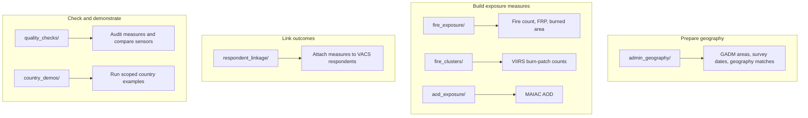

# Script entry points

Run from the repository root with `.venv/bin/python -m scripts.<folder>.<script_name>`.
Shared functions are in `utils/`.
The [repository overview](../README.md) shows how these roles connect for one country and survey period.

| Folder | Purpose |
| --- | --- |
| `admin_geography/` | Prepare GADM boundaries, survey timing, and geography matches. |
| `fire_exposure/` | Export and assemble MODIS, FIRMS, and VIIRS exposure tables. |
| `aod_exposure/` | Export and check MAIAC AOD tables. |
| `fire_clusters/` | Build and audit VIIRS burn-patch counts. |
| `respondent_linkage/` | Map VACS geography and join or verify respondent exposures. |
| `quality_checks/` | Check exposure summaries and compare sensors. |
| `country_demos/` | Run scoped Uganda and Zimbabwe examples. |

`build_vacs_gadm_linkage_workbook.py` runs at import time; invoking it with `--help` also writes its workbook. Review the source before running it.
