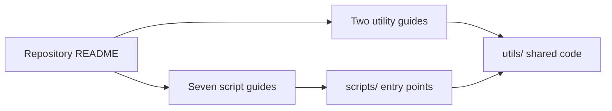

# Code guides

Start with the [repository overview](../README.md), then use the guide for the folder you want to review. Each guide links to its source files.

| Review area | Guides |
| --- | --- |
| Geography and linkage | [Admin geography](admin_geography.md), [respondent linkage](respondent_linkage.md) |
| Fire measures | [Fire exposure](fire_exposure.md), [fire clusters](fire_clusters.md), [country demos](country_demos.md) |
| AOD | [AOD exposure](aod_exposure.md), [AOD utilities](utils_aod.md) |
| Supporting code | [Shared utilities](utils_shared.md), [quality checks](quality_checks.md) |
