# Shared Python utilities

The `scripts/` entry points call these reusable modules. Each row below shows one utility role.

```mermaid
flowchart TB
  subgraph AREA["Areas and dates"]
    direction LR
    AREA_INPUT["GADM + survey dates"] --> AREA_UTIL["gadm_boundaries + vacs_survey_time"] --> AREA_OUTPUT["Areas + exposure windows"]
  end
  subgraph FIRE["Fire measures"]
    direction LR
    FIRE_INPUT["Satellite fire products"] --> FIRE_UTIL["adam_* + gee_fire_zonal"] --> FIRE_OUTPUT["Area summaries"]
  end
  subgraph IDN["Indonesia VIIRS"]
    direction LR
    IDN_INPUT["Indonesia VIIRS exports"] --> IDN_UTIL["indonesia_viirs"] --> IDN_OUTPUT["Batches + export checks"]
  end
  subgraph AOD["AOD measures"]
    direction LR
    AOD_INPUT["MAIAC images"] --> AOD_UTIL["aod/*"] --> AOD_OUTPUT["AOD windows + exports"]
  end
```

| Utility group | Role | File guide |
| --- | --- | --- |
| `adam_*`, `gee_fire_zonal.py` | Build satellite measures and summarize them within areas. | [Shared utilities](../skills/utils_shared.md) |
| `gadm_boundaries.py`, `vacs_survey_time.py` | Supply administrative areas and exposure windows. | [Shared utilities](../skills/utils_shared.md) |
| `indonesia_viirs.py` | Handle Indonesia boundaries, batches, and export checks. | [Shared utilities](../skills/utils_shared.md) |
| `aod/` | Prepare MAIAC images, AOD windows, boundaries, and checked exports. | [AOD utilities](../skills/utils_aod.md) |
| `repo_paths.py`, `plot_style.py` | Find the project root and apply chart styling. | [Shared utilities](../skills/utils_shared.md) |
